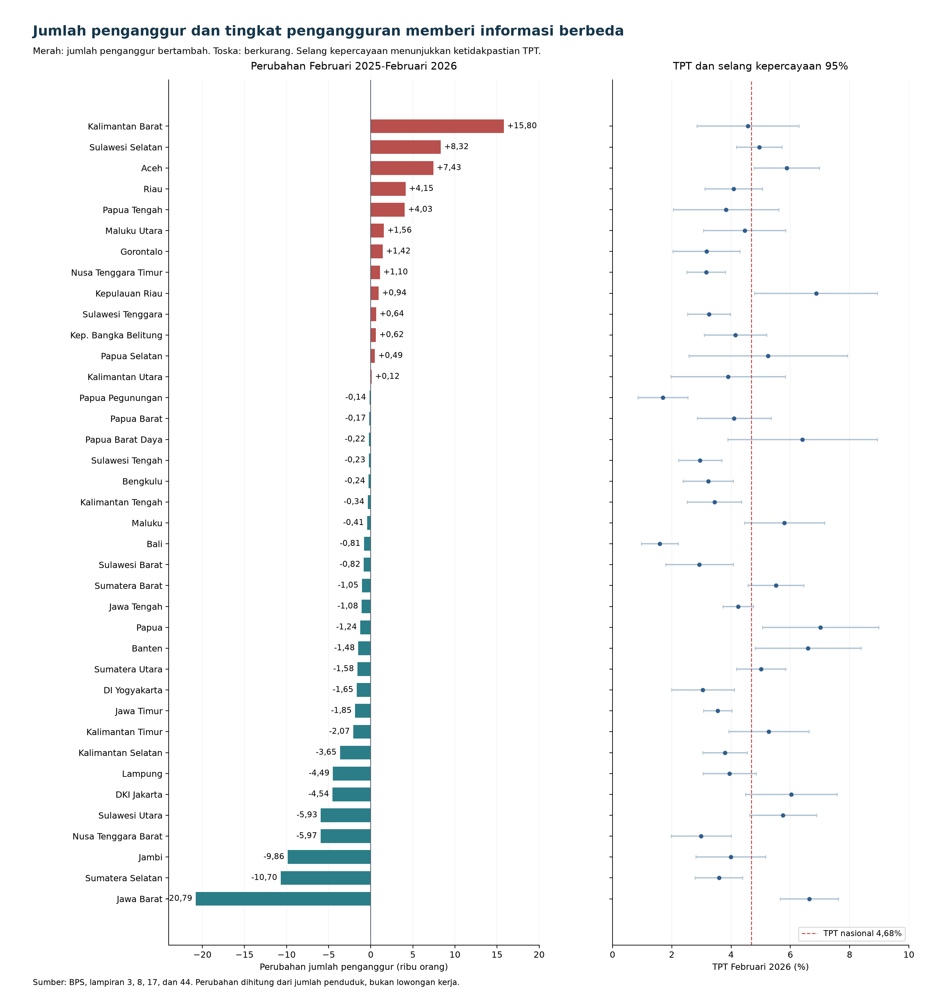
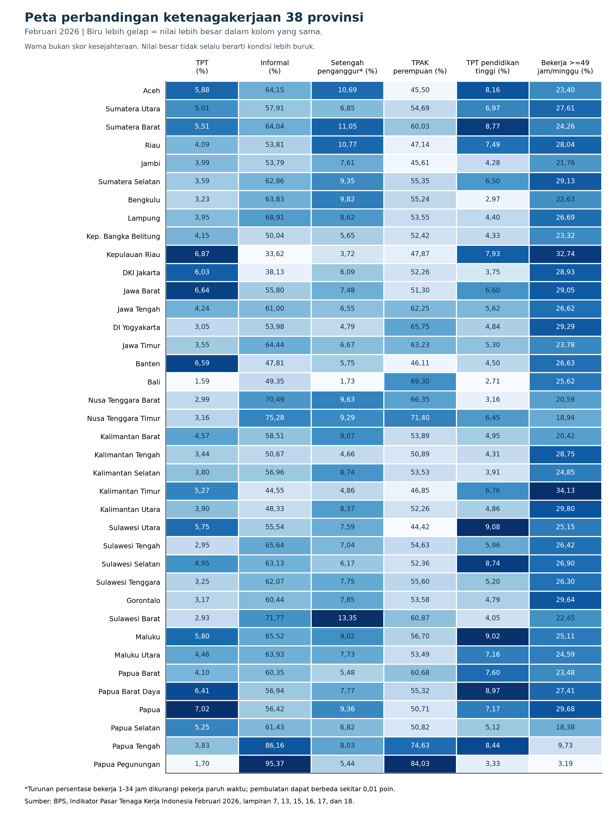

# Analisis Ketenagakerjaan Seluruh 38 Provinsi

**Periode:** Februari 2025–Februari 2026. **Tanggal penelusuran:** 14 Oktober 2026.

Analisis ini menggunakan tabel nasional BPS agar cakupan wilayah, periode, dan definisi konsisten. Februari 2026 dipilih karena publikasi lengkap dengan indikator lintas provinsi dan tabel ketidakpastian berhasil diperoleh. Rilis nasional Mei 2026 tersedia, tetapi tidak dicampurkan ke dalam pemetaan tahunan ini. Semua 38 provinsi tercakup, termasuk enam provinsi di wilayah Papua; Indonesia merupakan baris pembanding nasional, bukan provinsi ke-39.

## 1. Temuan utama

1. **Perbaikan nasional belum merata.** Angkatan kerja bertambah 1.861.748 orang, sedangkan penduduk bekerja bertambah 1.896.450 orang. Jumlah penganggur nasional berkurang 34.702 orang. Namun, jumlah penganggur bertambah di 13 provinsi dan berkurang di 25 provinsi. Kenaikan pada 13 provinsi mencapai 46.609 orang, sedangkan pengurangan pada 25 provinsi mencapai 81.311 orang.
2. **TPT turun dapat disertai kenaikan jumlah penganggur.** Pola ini ditemukan di Riau, Kep. Bangka Belitung, Kepulauan Riau, Nusa Tenggara Timur, Sulawesi Selatan, dan Sulawesi Tenggara. Artinya, pemetaan berdasarkan perubahan TPT saja dapat melewatkan pertambahan orang yang menganggur.
3. **TPT rendah tidak cukup untuk menilai kecukupan pekerjaan.** Sebanyak 15 provinsi memiliki TPT di bawah nasional, tetapi proporsi pekerja informal di atas nasional. Ini tidak membuktikan pekerjaan tidak layak, tetapi menuntut pemeriksaan jam kerja, pendapatan, dan perlindungan kerja.
4. **Pendidikan dan gender menunjukkan pola yang berbeda antarwilayah.** TPT pendidikan tinggi melebihi TPT pendidikan menengah di 18 provinsi. TPAK perempuan di bawah 50% ditemukan di tujuh provinsi. Kedua pola belum menjelaskan penyebabnya.
5. **Perubahan jumlah bekerja tidak selalu positif ketika pengangguran turun.** Di delapan provinsi, angkatan kerja, penduduk bekerja, dan penganggur sama-sama berkurang. Penurunan pengangguran di kelompok ini tidak dapat dipresentasikan sebagai bukti pertumbuhan jumlah pekerjaan.

## 2. Sumber, ukuran, dan batas interpretasi

Sumber utama adalah [BPS, Indikator Pasar Tenaga Kerja Indonesia Februari 2026](https://www.bps.go.id/id/publication/2026/06/26/f00a5821056e518c20d1546e/indikator-pasar-tenaga-kerja-indonesia-februari-2026.html), dirilis 26 Juni 2026, nomor publikasi 04100.26024. Nomor halaman di bawah merujuk halaman cetak; halaman PDF = halaman cetak + 28.

| Aspek | Ukuran yang digunakan | Sumber dan halaman cetak |
|---|---|---|
| Penyerapan dan pasokan tenaga kerja | Jumlah angkatan kerja dan penduduk bekerja; perubahan 2025–2026 | Lampiran 3, hlm. 136–137; lampiran 8, hlm. 142–143 |
| Pengangguran | Jumlah penganggur = angkatan kerja − bekerja; TPT total dan menurut gender | Lampiran 17, hlm. 157 |
| Partisipasi | TPAK total, laki-laki, perempuan; selisih gender | Lampiran 7, hlm. 141 |
| Penduduk bekerja terhadap usia kerja | EPR, bukan persentase bekerja terhadap angkatan kerja | Lampiran 9, hlm. 144 |
| Struktur pekerjaan | Formal/informal dan pekerja keluarga/tanpa dibayar | Lampiran 16, hlm. 156; lampiran 10, hlm. 146 |
| Jam kerja | Paruh waktu, bekerja 1–34 jam, dan bekerja 49 jam atau lebih | Lampiran 13, hlm. 152; lampiran 15, hlm. 154–155 |
| Pendidikan | TPT pendidikan dasar ke bawah, menengah, dan tinggi | Lampiran 18, hlm. 158 |
| Upah | Rata-rata upah buruh/karyawan/pegawai, bukan seluruh penduduk bekerja | Lampiran 24, hlm. 164 |
| Ketidakpastian | RSE dan selang kepercayaan 95% TPT | Lampiran 44, hlm. 183 |

**Selisih penyerapan = perubahan penduduk bekerja − perubahan angkatan kerja.** Secara identitas, nilainya sama dengan negatif perubahan jumlah penganggur. Karena itu, selisih tersebut bukan indikator independen tambahan dan bukan bukti penyebab pengangguran. Nilai positif berarti jumlah penganggur turun, tetapi perlu dibaca bersama arah perubahan angkatan kerja dan penduduk bekerja.

**Setengah pengangguran dalam tabel ini merupakan angka turunan:** persentase bekerja 1–34 jam dikurangi tingkat pekerja paruh waktu. Penduduk bekerja kurang dari 35 jam terdiri atas setengah penganggur dan pekerja paruh waktu. Semua kolom ini diberi penanda “perkiraan” pada CSV. Pembulatan kedua masukan dapat menimbulkan perbedaan sekitar 0,01 poin persentase dari angka resmi yang dihitung sebelum pembulatan. Contoh nasional: turunan 7,26%, sedangkan angka resmi nasional 7,27%. Angka tersebut tidak menggantikan angka resmi apabila tersedia untuk pendalaman provinsi.

TPT berpenyebut angkatan kerja. Formal/informal, paruh waktu, setengah pengangguran, pekerja keluarga, dan jam kerja berlebih berpenyebut penduduk bekerja. TPAK berpenyebut penduduk usia kerja. TPT pendidikan tinggi berpenyebut angkatan kerja berpendidikan tinggi, bukan seluruh lulusan pendidikan tinggi atau seluruh penganggur.

## 3. Dinamika angkatan kerja, bekerja, dan penganggur

Empat pola deskriptif ditemukan:

| Pola Februari 2025–2026 | Jumlah provinsi | Makna terbatas |
|---|---:|---|
| Angkatan kerja dan bekerja naik; penganggur turun | 17 | Pertambahan bekerja melampaui pertambahan angkatan kerja. |
| Angkatan kerja dan bekerja naik; penganggur naik | 11 | Pertambahan bekerja belum mengimbangi tambahan angkatan kerja. |
| Angkatan kerja dan bekerja turun; penganggur naik | 2 | Jumlah bekerja turun lebih besar; terjadi di Aceh dan Papua Selatan. |
| Angkatan kerja dan bekerja turun; penganggur turun | 8 | Pengurangan penganggur disertai menyusutnya angkatan kerja dan jumlah bekerja. |

Pada kelompok terakhir, penyebab keluar dari angkatan kerja belum diketahui. Jangan otomatis menyebutnya putus asa mencari pekerjaan, migrasi, atau pensiun tanpa data pendukung.

### Tabel seluruh provinsi: perubahan jumlah dan TPT

Satuan perubahan jumlah adalah **orang**, bukan lowongan. Δ berarti Februari 2026 dikurangi Februari 2025. Penganggur dihitung dari jumlah angkatan kerja dan penduduk bekerja. Nilai jumlah dipertahankan sesuai estimasi BPS; perubahan kecil belum tentu signifikan secara statistik.

| Provinsi | Δ angkatan kerja | Δ bekerja | Δ penganggur | TPT 2025 (%) | TPT 2026 (%) | Δ TPT (pp) | Δ TPAK (pp) |
| --- | --- | --- | --- | --- | --- | --- | --- |
| Aceh | -47.911 | -55.341 | 7.430 | 5,50 | 5,88 | 0,38 | -2,19 |
| Sumatera Utara | 26.494 | 28.078 | -1.584 | 5,05 | 5,01 | -0,04 | -0,85 |
| Sumatera Barat | 84.699 | 85.747 | -1.048 | 5,69 | 5,51 | -0,18 | 0,81 |
| Riau | 130.606 | 126.460 | 4.146 | 4,12 | 4,09 | -0,03 | 1,49 |
| Jambi | -12.939 | -3.081 | -9.858 | 4,48 | 3,99 | -0,49 | -1,42 |
| Sumatera Selatan | 88.283 | 98.983 | -10.700 | 3,89 | 3,59 | -0,30 | 0,33 |
| Bengkulu | -4.940 | -4.696 | -244 | 3,24 | 3,23 | -0,01 | -1,33 |
| Lampung | 30.039 | 34.526 | -4.487 | 4,07 | 3,95 | -0,12 | -0,51 |
| Kep. Bangka Belitung | 19.747 | 19.130 | 617 | 4,17 | 4,15 | -0,02 | 0,67 |
| Kepulauan Riau | 17.390 | 16.449 | 941 | 6,89 | 6,87 | -0,02 | -0,07 |
| DKI Jakarta | 57.643 | 62.181 | -4.538 | 6,18 | 6,03 | -0,15 | 0,08 |
| Jawa Barat | 89.408 | 110.194 | -20.786 | 6,74 | 6,64 | -0,10 | -0,78 |
| Jawa Tengah | 454.544 | 455.629 | -1.085 | 4,33 | 4,24 | -0,09 | 0,73 |
| DI Yogyakarta | 42.366 | 44.020 | -1.654 | 3,18 | 3,05 | -0,13 | 0,79 |
| Jawa Timur | 386.191 | 388.041 | -1.850 | 3,61 | 3,55 | -0,06 | 0,53 |
| Banten | 24.546 | 26.024 | -1.478 | 6,64 | 6,59 | -0,05 | -0,81 |
| Bali | -77.856 | -77.044 | -812 | 1,58 | 1,59 | 0,01 | -2,77 |
| Nusa Tenggara Barat | 45.232 | 51.198 | -5.966 | 3,22 | 2,99 | -0,23 | -0,32 |
| Nusa Tenggara Timur | 101.149 | 100.052 | 1.097 | 3,23 | 3,16 | -0,07 | 1,13 |
| Kalimantan Barat | 131.638 | 115.841 | 15.797 | 4,23 | 4,57 | 0,34 | 2,01 |
| Kalimantan Tengah | 6.333 | 6.677 | -344 | 3,47 | 3,44 | -0,03 | -0,70 |
| Kalimantan Selatan | -8.887 | -5.239 | -3.648 | 3,94 | 3,80 | -0,14 | -1,34 |
| Kalimantan Timur | -16.850 | -14.776 | -2.074 | 5,33 | 5,27 | -0,06 | -0,15 |
| Kalimantan Utara | 2.800 | 2.683 | 117 | 3,90 | 3,90 | 0,00 | -0,56 |
| Sulawesi Utara | -35.224 | -29.292 | -5.932 | 6,03 | 5,75 | -0,28 | -2,27 |
| Sulawesi Tengah | 27.208 | 27.434 | -226 | 3,02 | 2,95 | -0,07 | 0,13 |
| Sulawesi Selatan | 179.226 | 170.904 | 8.322 | 4,96 | 4,95 | -0,01 | 1,60 |
| Sulawesi Tenggara | 27.414 | 26.770 | 644 | 3,27 | 3,25 | -0,02 | 0,02 |
| Gorontalo | 35.255 | 33.836 | 1.419 | 3,12 | 3,17 | 0,05 | 2,81 |
| Sulawesi Barat | 35.794 | 36.613 | -819 | 3,17 | 2,93 | -0,24 | 1,94 |
| Maluku | 18.476 | 18.885 | -409 | 5,95 | 5,80 | -0,15 | 0,28 |
| Maluku Utara | 4.762 | 3.202 | 1.560 | 4,26 | 4,46 | 0,20 | -0,71 |
| Papua Barat | 3.861 | 4.026 | -165 | 4,21 | 4,10 | -0,11 | -0,33 |
| Papua Barat Daya | 6.477 | 6.699 | -222 | 6,61 | 6,41 | -0,20 | 0,44 |
| Papua | -25.000 | -23.762 | -1.238 | 6,92 | 7,02 | 0,10 | -4,68 |
| Papua Selatan | -5.893 | -6.385 | 492 | 4,90 | 5,25 | 0,35 | -3,32 |
| Papua Tengah | 41.427 | 37.400 | 4.027 | 3,55 | 3,83 | 0,28 | 2,77 |
| Papua Pegunungan | -21.760 | -21.616 | -144 | 1,68 | 1,70 | 0,02 | -2,40 |
| Indonesia | 1.861.748 | 1.896.450 | -34.702 | 4,76 | 4,68 | -0,08 | -0,04 |

**Kalimantan Barat** memiliki kenaikan jumlah penganggur terbesar secara absolut, 15.797 orang. Angkatan kerja bertambah 131.638 orang, sedangkan penduduk bekerja bertambah 115.841 orang. TPT naik dari 4,23% menjadi 4,57%. Ini kandidat untuk menelusuri mengapa pertumbuhan jumlah bekerja belum mengimbangi tambahan angkatan kerja, bukan bukti bahwa suatu sektor atau kelompok tertentu menjadi penyebabnya.

**Aceh** memiliki pola berbeda: jumlah angkatan kerja turun 47.911 dan penduduk bekerja turun 55.341; penganggur bertambah 7.430. TPAK turun 2,19 poin. Karena pasokan yang aktif juga menyusut, masalahnya tidak tepat diringkas sebagai “terlalu banyak lulusan baru”.

**Jawa Barat** mencatat pengurangan jumlah penganggur terbesar secara absolut, 20.786 orang. Namun, jumlah penganggur yang tersisa masih 1.786.425 orang dan TPT 6,64%. Besarnya penurunan dan besarnya beban pengangguran saat ini merupakan informasi yang berbeda. Lima provinsi dengan jumlah penganggur terbanyak—Jawa Barat, Jawa Tengah, Jawa Timur, Banten, dan Sumatera Utara—menampung sekitar 61,35% penganggur nasional. Ini ukuran konsentrasi jumlah, bukan ukuran risiko individual.

## 4. Struktur pekerjaan dan jam kerja

### Tabel seluruh provinsi: informalitas, kecukupan jam, dan jam panjang

Semua angka adalah persentase penduduk bekerja pada Februari 2026. Setengah penganggur bertanda * merupakan turunan dari dua persentase yang dibulatkan. Pekerja paruh waktu tidak otomatis kekurangan pekerjaan karena mereka tidak mencari/tidak bersedia menerima tambahan pekerjaan menurut definisi yang digunakan.

| Provinsi | Informal (%) | Pekerja keluarga (%) | Paruh waktu (%) | Setengah penganggur* (%) | >=49 jam (%) |
| --- | --- | --- | --- | --- | --- |
| Aceh | 64,15 | 13,42 | 28,84 | 10,69* | 23,40 |
| Sumatera Utara | 57,91 | 14,27 | 25,33 | 6,85* | 27,61 |
| Sumatera Barat | 64,04 | 15,08 | 29,02 | 11,05* | 24,26 |
| Riau | 53,81 | 11,39 | 26,91 | 10,77* | 28,04 |
| Jambi | 53,79 | 13,15 | 30,23 | 7,61* | 21,76 |
| Sumatera Selatan | 62,86 | 16,71 | 26,56 | 9,35* | 29,13 |
| Bengkulu | 63,83 | 15,93 | 32,54 | 9,82* | 22,63 |
| Lampung | 68,91 | 17,58 | 31,45 | 8,62* | 26,69 |
| Kep. Bangka Belitung | 50,04 | 8,88 | 24,52 | 5,65* | 23,32 |
| Kepulauan Riau | 33,62 | 5,75 | 15,09 | 3,72* | 32,74 |
| DKI Jakarta | 38,13 | 5,61 | 12,79 | 6,09* | 28,93 |
| Jawa Barat | 55,80 | 9,91 | 20,71 | 7,48* | 29,05 |
| Jawa Tengah | 61,00 | 12,91 | 24,53 | 6,55* | 26,62 |
| DI Yogyakarta | 53,98 | 12,91 | 23,46 | 4,79* | 29,29 |
| Jawa Timur | 64,44 | 15,14 | 30,52 | 6,67* | 23,78 |
| Banten | 47,81 | 8,31 | 15,85 | 5,75* | 26,63 |
| Bali | 49,35 | 10,17 | 21,80 | 1,73* | 25,62 |
| Nusa Tenggara Barat | 70,49 | 16,32 | 35,92 | 9,63* | 20,59 |
| Nusa Tenggara Timur | 75,28 | 26,20 | 37,37 | 9,29* | 18,94 |
| Kalimantan Barat | 58,51 | 14,50 | 29,46 | 9,07* | 20,42 |
| Kalimantan Tengah | 50,67 | 11,44 | 25,36 | 4,66* | 28,75 |
| Kalimantan Selatan | 56,96 | 13,78 | 30,24 | 8,74* | 24,85 |
| Kalimantan Timur | 44,55 | 11,62 | 21,18 | 4,86* | 34,13 |
| Kalimantan Utara | 48,33 | 14,06 | 23,96 | 8,37* | 29,80 |
| Sulawesi Utara | 55,54 | 9,29 | 22,15 | 7,59* | 25,15 |
| Sulawesi Tengah | 65,64 | 17,52 | 27,78 | 7,04* | 26,42 |
| Sulawesi Selatan | 63,13 | 18,05 | 31,34 | 6,17* | 26,90 |
| Sulawesi Tenggara | 62,07 | 17,26 | 29,94 | 7,75* | 26,30 |
| Gorontalo | 60,44 | 10,90 | 29,82 | 7,85* | 29,64 |
| Sulawesi Barat | 71,77 | 17,55 | 35,31 | 13,35* | 22,45 |
| Maluku | 65,52 | 17,72 | 28,98 | 9,02* | 25,11 |
| Maluku Utara | 63,93 | 14,87 | 29,38 | 7,73* | 24,59 |
| Papua Barat | 60,35 | 18,18 | 21,96 | 5,48* | 23,48 |
| Papua Barat Daya | 56,94 | 16,01 | 27,20 | 7,77* | 27,41 |
| Papua | 56,42 | 11,91 | 23,93 | 9,36* | 29,68 |
| Papua Selatan | 61,43 | 16,78 | 30,95 | 6,82* | 18,38 |
| Papua Tengah | 86,16 | 36,18 | 36,87 | 8,03* | 9,73 |
| Papua Pegunungan | 95,37 | 53,33 | 48,11 | 5,44* | 3,19 |
| Indonesia | 59,42 | 13,67 | 25,97 | 7,26* | 26,06 |

**Sulawesi Barat** menonjol: TPT 2,93%, informal 71,77%, dan setengah pengangguran sekitar 13,35%. Dibanding TPT nasional 4,68%, angka pengangguran terbukanya rendah, tetapi kecukupan jam kerja masih perlu diperiksa. Arah analisis yang relevan adalah apakah masyarakat sudah bekerja namun belum memperoleh jam kerja yang diinginkan.

**Nusa Tenggara Timur** memiliki TPT 3,16%, informal 75,28%, pekerja keluarga/tanpa dibayar 26,20%, dan setengah pengangguran sekitar 9,29%. Ini alasan untuk membaca pengangguran bersama struktur pekerjaan, tanpa menyatakan semua pekerja informal atau keluarga hidup tidak sejahtera.

**Papua Pegunungan** memiliki TPT 1,70%, informal 95,37%, dan pekerja keluarga/tanpa dibayar 53,33%. Rendahnya pengangguran terbuka tidak dapat langsung dipakai sebagai bukti melimpahnya pekerjaan bergaji. Namun, indikator ini juga belum mengukur pendapatan usaha atau kesejahteraan rumah tangga secara keseluruhan.

**Kalimantan Timur** memiliki proporsi bekerja 49 jam atau lebih sebesar 34,13%, terbesar secara deskriptif di tabel ini. Jam panjang tidak otomatis membuktikan pelanggaran aturan kerja karena ukuran mencakup seluruh pekerjaan dan beragam status pekerja. Perlu pendalaman status pekerjaan, upah, dan jumlah pekerjaan sebelum menilai beban kerja serta kompensasinya.

## 5. Gender, pendidikan, dan upah

### Tabel seluruh provinsi: partisipasi, pendidikan tinggi, dan upah buruh

Gap TPAK adalah TPAK laki-laki dikurangi perempuan, dalam poin persentase. Upah merupakan rata-rata nominal bulanan buruh/karyawan/pegawai. Angka upah tidak dapat langsung dibandingkan sebagai ukuran daya beli karena biaya hidup, komposisi pekerjaan, dan jam kerja berbeda.

| Provinsi | TPAK total (%) | TPAK perempuan (%) | Gap TPAK (pp) | TPT pendidikan tinggi (%) | Upah buruh (Rp) |
| --- | --- | --- | --- | --- | --- |
| Aceh | 63,44 | 45,50 | 35,95 | 8,16 | 2.708.851 |
| Sumatera Utara | 69,28 | 54,69 | 29,27 | 6,97 | 2.834.664 |
| Sumatera Barat | 71,76 | 60,03 | 23,39 | 8,77 | 2.925.552 |
| Riau | 66,17 | 47,14 | 37,34 | 7,49 | 3.204.627 |
| Jambi | 65,69 | 45,61 | 39,60 | 4,28 | 3.154.942 |
| Sumatera Selatan | 70,89 | 55,35 | 30,59 | 6,50 | 2.974.233 |
| Bengkulu | 70,17 | 55,24 | 29,28 | 2,97 | 2.773.023 |
| Lampung | 70,65 | 53,55 | 33,56 | 4,40 | 2.571.448 |
| Kep. Bangka Belitung | 68,34 | 52,42 | 31,05 | 4,33 | 3.257.460 |
| Kepulauan Riau | 66,77 | 47,87 | 37,35 | 7,93 | 4.740.135 |
| DKI Jakarta | 65,48 | 52,26 | 26,57 | 3,75 | 5.229.472 |
| Jawa Barat | 68,13 | 51,30 | 33,39 | 6,60 | 3.712.133 |
| Jawa Tengah | 73,90 | 62,25 | 23,31 | 5,62 | 2.462.759 |
| DI Yogyakarta | 74,52 | 65,75 | 17,89 | 4,84 | 2.940.990 |
| Jawa Timur | 74,78 | 63,23 | 23,32 | 5,30 | 2.715.212 |
| Banten | 65,01 | 46,11 | 37,30 | 4,50 | 4.197.367 |
| Bali | 74,63 | 69,30 | 10,70 | 2,71 | 4.064.938 |
| Nusa Tenggara Barat | 76,18 | 66,35 | 19,68 | 3,16 | 2.678.084 |
| Nusa Tenggara Timur | 76,94 | 71,40 | 11,16 | 6,45 | 2.563.541 |
| Kalimantan Barat | 69,65 | 53,89 | 30,71 | 4,95 | 2.962.374 |
| Kalimantan Tengah | 69,20 | 50,89 | 35,43 | 4,31 | 3.542.959 |
| Kalimantan Selatan | 69,07 | 53,53 | 30,88 | 3,91 | 3.393.313 |
| Kalimantan Timur | 66,25 | 46,85 | 37,40 | 6,76 | 4.561.415 |
| Kalimantan Utara | 68,63 | 52,26 | 30,98 | 4,86 | 3.963.394 |
| Sulawesi Utara | 63,03 | 44,42 | 36,52 | 9,08 | 3.486.792 |
| Sulawesi Tengah | 70,64 | 54,63 | 31,22 | 5,96 | 3.436.857 |
| Sulawesi Selatan | 67,59 | 52,36 | 30,91 | 8,74 | 3.095.285 |
| Sulawesi Tenggara | 69,79 | 55,60 | 28,04 | 5,20 | 3.201.344 |
| Gorontalo | 70,33 | 53,58 | 33,34 | 4,79 | 2.843.777 |
| Sulawesi Barat | 73,75 | 60,87 | 25,42 | 4,05 | 2.749.811 |
| Maluku | 67,84 | 56,70 | 22,11 | 9,02 | 2.885.206 |
| Maluku Utara | 68,28 | 53,49 | 28,61 | 7,16 | 3.566.838 |
| Papua Barat | 71,12 | 60,68 | 19,71 | 7,60 | 3.629.374 |
| Papua Barat Daya | 68,58 | 55,32 | 25,32 | 8,97 | 3.682.560 |
| Papua | 65,70 | 50,71 | 28,38 | 7,17 | 4.333.585 |
| Papua Selatan | 64,83 | 50,82 | 26,71 | 5,12 | 3.707.110 |
| Papua Tengah | 81,74 | 74,63 | 13,23 | 8,44 | 5.091.978 |
| Papua Pegunungan | 85,87 | 84,03 | 3,43 | 3,33 | 4.310.201 |
| Indonesia | 70,56 | 56,41 | 28,16 | 5,89 | 3.287.675 |

**Jambi** memiliki gap TPAK gender terbesar, 39,60 poin: laki-laki 85,21%, perempuan 45,61%. Tujuh provinsi memiliki TPAK perempuan di bawah 50%: Aceh, Riau, Jambi, Kepulauan Riau, Banten, Kalimantan Timur, dan Sulawesi Utara. Rendahnya partisipasi tidak otomatis membuktikan diskriminasi atau kekurangan lowongan; dapat terkait pendidikan, tanggung jawab rumah tangga, preferensi, dan hambatan lain yang belum diuji.

**Pendidikan tinggi:** Sulawesi Utara (9,08%), Maluku (9,02%), Papua Barat Daya (8,97%), Sumatera Barat (8,77%), dan Sulawesi Selatan (8,74%) memiliki estimasi TPT pendidikan tinggi terbesar. Di 18 provinsi, TPT pendidikan tinggi lebih besar daripada pendidikan menengah. Temuan ini belum mengukur kemampuan coding, Excel, atau kebutuhan jurusan tertentu. Pengelompokan publikasi mengacu ISCED-97 yang disesuaikan: menengah mencakup SMA/MA, SMK, dan Paket C; tinggi mencakup Diploma I/II/III, Diploma IV/S1, serta S2/S3 (penjelasan hlm. cetak 123). Perbedaan usia, masa transisi setelah lulus, dan preferensi pekerjaan perlu dipertimbangkan.

**Upah:** rata-rata nominal buruh tertinggi ditemukan di DKI Jakarta, Rp5.229.472 per bulan, dan terendah di Jawa Tengah, Rp2.462.759. Papua Tengah memiliki rata-rata Rp5.091.978 meskipun informalitas 86,16%. Tidak ada kontradiksi: rata-rata tersebut hanya menggambarkan buruh/karyawan/pegawai, bukan semua penduduk bekerja. Menggunakan angka itu sebagai gambaran pendapatan seluruh pekerja Papua Tengah akan keliru.

## 6. Kandidat pendalaman berdasarkan bukti

Tiga arah berikut belum merupakan keputusan konsep infografis. Pemilihannya berasal dari pola yang berbeda dan dapat dipertajam bersama pengguna.

| Arah pertanyaan | Kandidat wilayah | Dasar pemilihan | Data lanjutan yang diperlukan |
|---|---|---|---|
| Mengapa pertumbuhan jumlah bekerja belum mengimbangi tambahan angkatan kerja? | Kalimantan Barat; Sulawesi Selatan sebagai pembanding | Penganggur bertambah 15.797 dan 8.322 orang ketika jumlah bekerja dan angkatan kerja sama-sama naik. | Perubahan lapangan usaha, status pekerjaan, pendidikan dan usia angkatan kerja; beberapa tahun pengamatan. |
| Apakah TPT rendah disertai kecukupan pekerjaan? | Sulawesi Barat dan Nusa Tenggara Timur | TPT rendah, informalitas tinggi, dan setengah pengangguran di atas angka nasional. | Upah/pendapatan menurut status kerja, sektor, kebutuhan tambahan jam, serta indikator kesejahteraan yang sepadan. |
| Siapa yang masih menghadapi hambatan meskipun indikator agregat membaik? | Sulawesi Utara atau Sumatera Barat untuk pendidikan; Jambi untuk partisipasi perempuan | TPT pendidikan tinggi relatif tinggi atau gap partisipasi gender besar. | Karakteristik umur, durasi mencari pekerjaan, bidang studi jika tersedia, dan alasan tidak aktif secara ekonomi. |

Aceh tetap layak menjadi kandidat terpisah apabila fokus bergeser pada penurunan jumlah bekerja dan partisipasi perempuan. Jangan menggabungkan semua kandidat ke dalam satu poster tanpa pertanyaan utama yang jelas.

## 7. Keterbatasan dan langkah validasi

- Data merupakan estimasi survei. Peringkat berdasarkan angka titik tidak membuktikan perbedaan signifikan. Contohnya, TPT Papua 7,02% memiliki CI 95% 5,06–8,98%; Kepulauan Riau 6,87% memiliki CI 4,79–8,94%. Selang yang lebar membuat klaim “provinsi pertama pasti lebih buruk” tidak tepat.
- Kenaikan/penurunan tahunan belum diuji signifikansinya. CI TPT satu tahun tidak cukup untuk menguji perubahan tahunan; diperlukan varians perubahan dan, jika relevan, kovarians antarperiode.
- Selisih penyerapan merupakan perubahan bersih, bukan jumlah lowongan, rekrutmen, PHK, atau penempatan lulusan baru. Provinsi penduduk juga tidak otomatis menunjukkan lokasi perusahaan tempat mereka bekerja, terutama bila ada komuter.
- Setengah pengangguran adalah turunan dengan potensi selisih pembulatan; verifikasi angka resmi wilayah terpilih sebelum digunakan pada karya akhir.
- Informalitas, pekerja keluarga, jam panjang, dan upah rata-rata merupakan indikator terpisah. Tidak dibuat skor gabungan “provinsi terburuk” karena pembobotan dan maknanya belum disepakati.
- Data tidak membuktikan penyebab: ketidakcocokan keterampilan, syarat usia/penampilan, kualitas jurusan, atau eksploitasi kerja belum diukur langsung.
- Sektor ekonomi dan pengangguran usia muda belum dimasukkan sebagai tabel lengkap lintas provinsi dalam tahap ini. Keduanya dapat digunakan untuk pendalaman wilayah, dengan sumber serta periode yang sepadan.

**Validasi berikutnya:** pilih pertanyaan dan 2–3 wilayah kandidat, periksa konsistensi selama beberapa tahun dengan bulan sama, konfirmasi angka turunan pada BRS daerah, lalu telusuri komposisi sektor, umur, dan pendidikan. Rekomendasi tindakan disusun setelah pola tersebut memperoleh dukungan bukti, bukan dari peringkat satu tahun saja.

## 8. Berkas dan pemeriksaan data

- `data_38_provinsi_feb2025_feb2026.csv`: 38 baris provinsi dan satu baris nasional; mencakup nilai sumber serta hasil perhitungan.
- `data_provinsi.json`: data yang sama beserta lokasi halaman sumber untuk setiap indikator masukan.
- `Indikator_Pasar_Tenaga_Kerja_Februari_2026_BPS.pdf`: publikasi resmi yang diunduh dari BPS.
- `peta_indikator_38_provinsi.png` dan `dinamika_pengangguran_38_provinsi.png`: visual eksplorasi data.

Pemeriksaan yang dilakukan: cakupan 38 provinsi, kesesuaian nama wilayah, identitas penduduk usia kerja = angkatan kerja + bukan angkatan kerja, penganggur = angkatan kerja − bekerja, kecocokan TPT hasil perhitungan terhadap angka publikasi, formal + informal = 100%, serta penjumlahan provinsi terhadap total nasional untuk jumlah penduduk dan pekerja paruh waktu. Tabel formal/informal dan ketidakpastian TPT juga diperiksa secara visual pada PDF sumber.
